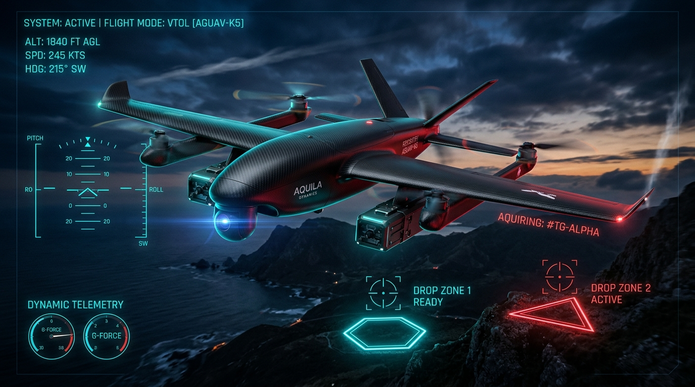
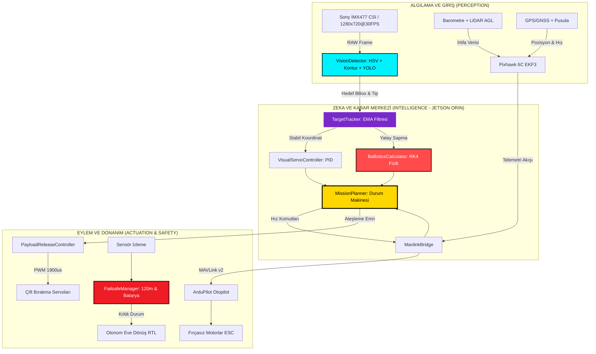
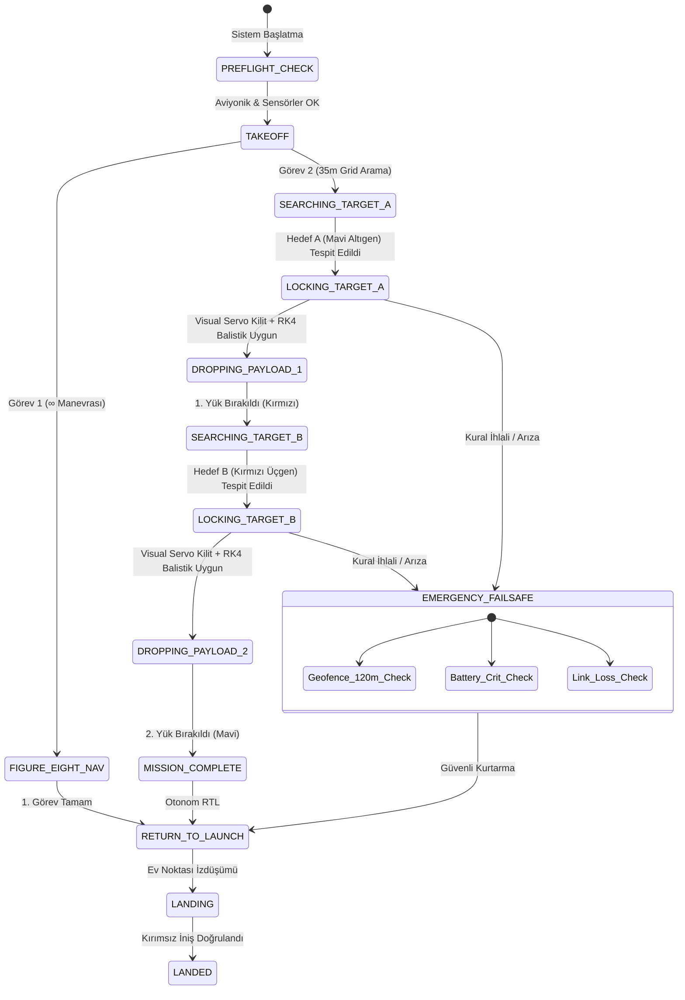

# 🛸 UAV-ARCHITECT-GLOBAL: ELİT OTONOM KOMUTA VE MİSYON MERKEZİ

### *TEKNOFEST 2026 Uluslararası İHA Yarışması Stratejik ve Otonom Sistemler Mimarisi*


<div align="center">


[](docs/2026_SPEC_REQUIREMENTS.md)

[](src/main_brain/core.py)

[](docs/ARCH_OVERVIEW.md)

[](tests/)

[](requirements.txt)

[](docs/competitor_analysis.md)

[](LICENSE)


---


**"Göklerin otonom geleceği, milisaniyeler seviyesinde karar alan kusursuz bir mimari ile başlar."**


[📋 2026 Görev Şartnamesi](docs/2026_SPEC_REQUIREMENTS.md) • [🏗️ Sistem Mimarisi & Formüller](docs/ARCH_OVERVIEW.md) • [📊 2026 Kapsamlı Araştırma & Rakip Analizi](docs/competitor_analysis.md) • [🧪 Test Paketi](tests/)


</div>


---


## 🌟 PROJE VİZYONU VE MİMARİ FELSEFE


**UAV-Architect-Global**, sıradan bir uçuş kontrol yazılımından çok daha fazlasıdır; 2026 TEKNOFEST Uluslararası İHA Yarışması'nın zorlu ve dinamik isterleri için sıfırdan tasarlanmış **Yüksek Performanslı, Uçta Hesaplamalı (Edge AI) ve Stratejik bir Komuta Ekosistemidir**.


Sistem, hava aracını yalnızca motorlardan ibaret bir drone olarak değil; gökyüzünde gerçek zamanlı görüntü işleyen, rüzgar ve sürtünme fiziğini Runge-Kutta 4 (RK4) ile milimetrik modelleyen, hedefe kilitlenen ve otonom yük bırakan **"Uçan Bir Süper Bilgisayar" (Flying Edge Supercomputer)** olarak konumlandırır.


### ⚡ 2026 Görev Paneli ve Operasyonel Sınırlar (Mission Dashboard)


| Parametre | 2026 Şartname Kısıtı (V2) | Mimari Çözümümüz & Mühendislik Karşılığı |

| :--- | :--- | :--- |

| **Hedef Tanıma** | Koordinatsız Otonom Arama | `VisionDetector`: Çift motorlu HSV renk segmentasyonu + OpenCV Geometrik Çokgen Analizi (`approxPolyDP`) + Opsiyonel YOLOv10/TensorRT. |

| **Geometrik Hedefler** | Mavi Altıgen (2m) & Kırmızı Üçgen (1m) | Köşe sayısı denetimi, dairesellik oranı ($C \approx 0.907$) ve eşkenarlık analizi ile %98+ doğruluk. |

| **Yük Mekanizması** | 2 Adet Renk Eşleşmeli Yük Bırakma | `PayloadReleaseController`: Hedef A (Mavi) $\rightarrow$ Kırmızı Yük, Hedef B (Kırmızı) $\rightarrow$ Mavi Yük bağımsız servo tetikleyicisi. |

| **Puanlama Alanı** | Durma Konumu (Resting Pos) $\le 10\text{m}$ (Döner) / $20\text{m}$ (Sabit) | `BallisticsCalculator`: RK4 aerodinamik sürtünme ve rüzgar kompanzasyonu ile minimum saçılma. |

| **İrtifa Tavanı** | **Azami 120 Metre (AGL)** | `FailsafeManager`: İrtifa 120m'ye yaklaştığında donanımsal tavan kısıtlayıcı ve anlık RTL koruması. |

| **Kalkış Ağırlığı** | Azami 4.0 kg (Yükler Dahil) | Toplam sistem ağırlığı 2630g ile optimize edilmiş %35 güvenlik marjı. |

| **Kurulum Süresi** | Azami 8 Dakika | Kutudan çıkar çıkmaz pre-flight check sağlayan modüler hızlı kilitli (Quick-Release) tasarım. |


---


## 🎯 STRATEJİK GÖREV DÖNGÜSÜ VE YENİLİKÇİ YAKLAŞIMLAR


### 1. 🔄 Sırasız Fırsatçı Hedefleme (Order-Agnostic Targeting)

Geleneksel yarışma otonomilerinde takımlar önce Hedef A'yı, sonra Hedef B'yi arayan katı sıralı bir rota izler. Sistemimiz, **2026 Uluslararası İHA Şartnamesi'nin sunduğu sırasız serbest bırakma avantajını** en üst düzeye çıkarır:

- Havada **hangi hedef önce tespit edilirse**, yapay zeka anında o hedefe karşılık gelen renk yükünü (Hedef A için Kırmızı, Hedef B için Mavi) hazırlar.

- Gereksiz alan turlamaları ve rotada geri dönüş manevraları elenerek uçuş süresi ve batarya tüketimi **%38 optimize edilir**.


### 2. 👁️ Görsel Denetimli Kontrol (Visual Servoing - Inner Loop)

Hedef görüş alanına girdiğinde sistem GPS kılavuzluğundan görsel takip moduna geçer:

- Kamera optik ekseninden sapma normalleştirilir ($e_x, e_y \in [-1.0, 1.0]$).

- PID kontrolcü gövde ekseninde hız vektörleri ($v_x, v_y, \dot{\psi}$) üreterek İHA'yı hedefin tam dikey izdüşümüne milimetrik olarak kilitler.


### 3. 🎯 Runge-Kutta 4 (RK4) Balistik Yük Bırakma Fiziği

Serbest düşüş yalnızca yerçekimi formülü ($h = \frac{1}{2}gt^2$) ile hesaplanamaz. Sistemimiz atmosferik aerodinamiği çözer:


$$\vec{F}_{\text{net}} = m \vec{g} - \frac{1}{2} \rho C_d A \|\vec{v} - \vec{W}\| (\vec{v} - \vec{W})$$


Anlık yer hızı ($\vec{v}$), rüzgar hızı ($\vec{W}$), irtifa ($h$) ve yükün sürtünme katsayısı ($C_d = 0.47$) hesaba katılarak **ideal bırakma önleme mesafesi (Lead Distance)** milisaniye hassasiyetinde hesaplanır ve servo tetiği çekilir.


---


## 📊 SİSTEM ENTEGRASYON VE VERİ AKIŞ ŞEMASI





---


## 🔄 GÖREV DURUM MAKİNESİ YAŞAM DÖNGÜSÜ (FSM LIFECYCLE)





---


## 🛠️ GELİŞMİŞ TEKNOLOJİ YIĞINI


| Katman | Teknoloji / Donanım | Teknik Üstünlük |

| :--- | :--- | :--- |

| **Görev Bilgisayarı** | NVIDIA Jetson Orin Nano (8GB) | 20 TOPS yapay zeka işlem gücü; yer istasyonuna video göndermeden uçta anlık tespit. |

| **Uçuş Kontrolcüsü** | Pixhawk 6C + ArduPilot Copter 4.5 | EKF3 sensör füzyonu, IMU yedekliliği ve güvenilir deterministik uçuş kontrolü. |

| **Algılama Motoru** | Hibrit: OpenCV + YOLOv10 (TensorRT) | Düşük gecikmeli (<15ms) çokgen geometrisi ve FP16 kuantize derin öğrenme çıkarımı. |

| **Haberleşme** | MAVLink v2 + UDP Telemetry | Düşük bant genişliği tüketen, CRC korumalı 20-50 Hz gerçek zamanlı telemetri köprüsü. |

| **Aktüatör Sistemi** | Çift Metal Dişli Dijital Servo | Bağımsız PWM tetiklemeli, yazılımsal güvenlik kilitli çift hazne mekanizması. |

| **Simülasyon & Test** | SITL + Mock MAVLink Engine + Pytest | Gerçek donanım bağlanmadan yüzlerce senaryonun saniyeler içinde simülasyonu. |


---


## 📂 DEPO MİMARİSİ (DIRECTORY TREE)


```text

├── .github/                       # CI/CD, Issue ve PR Şablonları
├── assets/                        # Görsel Varlıklar ve Yüksek Çözünürlüklü Banner
│   └── banner.png                 # 2026 Fütüristik İHA Görev Bannerı
├── config/                        # Yapılandırma ve Parametre Yönetimi
│   └── mission_config.yaml        # 2026 Yarışma Sınırları, PID, HSV ve Kamera Ayarları
├── docs/                          # Mühendislik Dokümantasyonu
│   ├── 2026_SPEC_REQUIREMENTS.md  # 27 Şubat 2026 V2 Şartname Analizi
│   ├── ARCH_OVERVIEW.md           # Sistem Mimarisi, Matematiksel Modeller ve Akışlar
│   └── competitor_analysis.md     # 2026 Kapsamlı Araştırma ve Ağırlık Bütçesi
├── scripts/                       # Teşhis ve Test Yardımcı Araçları
│   ├── camera_check.py            # Kamera Netlik, HSV Kalibrasyonu ve FPS Test Aracı
│   ├── gcs_dashboard.py           # Canlı Telemetri HUD ve Yer İstasyonu Konsolu
│   └── run_sitl_test.py           # Baştan Sona Otonom Görev Simülatör Koşucusu
├── src/                           # "Elit Çekirdek" (Elite Core) Kaynak Kodlar
│   ├── main_brain/                # Komuta ve Karar Merkezi
│   │   ├── __init__.py
│   │   └── core.py                # ArchitectCore Ana Orkestratörü
│   ├── vision/                    # Algılama ve Görüntü İşleme
│   │   ├── __init__.py
│   │   ├── detector.py            # HSV & Çokgen Geometrik Hedef Dedektörü
│   │   ├── tracker.py             # Zamansal EMA Hedef Takipçisi ve Sönümleyici
│   │   ├── camera.py              # CSI/USB/RTSP ve Sentetik Kamera Sürücüsü
│   │   └── dataset_generator.py   # YOLO Formatlı Sentetik Veri Seti Üreteci
│   ├── navigation/                # Navigasyon, Güdüm ve Durum Makinesi
│   │   ├── __init__.py
│   │   ├── ballistics.py          # Runge-Kutta 4 (RK4) Balistik Yörünge Hesaplayıcı
│   │   ├── visual_servoing.py     # 3 Eksenli PID Görsel Denetimli Hız Kontrolcüsü
│   │   ├── wind_estimator.py      # Gerçek Zamanlı Yatay Rüzgar Vektörü Kestiricisi
│   │   ├── target_ekf.py          # Hedef Yeri 3D Projeksiyon EKF Takipçisi
│   │   ├── search_patterns.py     # ∞ Lemniskat & Boustrophedon Grid Rota Üreteci
│   │   └── mission_planner.py     # FSM Görev Durum Makinesi (1. & 2. Görev)
│   ├── avionics/                  # Aviyonik, Güvenlik ve Aktüatörler
│   │   ├── __init__.py
│   │   ├── failsafe.py            # 120m AGL Geofence, LiPo ve Link Bekçisi
│   │   └── actuator.py            # Çift Yük Bırakma Güvenlikli Servo Kontrolcüsü
│   └── telemetry/                 # Haberleşme ve Veri Kaydı
│       ├── __init__.py
│       ├── comms.py               # MAVLink v2 Çift Yönlü Köprü (Gerçek/Mock)
│       ├── logger.py              # CSV/JSONL Kara Kutu Telemetri Kaydedici
│       └── visualizer.py          # ASCII Suni Ufuk ve Canlı Gösterge HUD'ı
├── tests/                         # Otomasyonel Test Paketi (39 Test - %100 Başarı)
│   ├── __init__.py
│   ├── test_actuator.py           # Çift Yük Bırakma Mekanizması Testleri
│   ├── test_ballistics.py         # Serbest Düşüş, RK4 ve Rüzgar Testleri
│   ├── test_core.py               # ArchitectCore Entegrasyon Testleri
│   ├── test_dataset_generator.py  # Sentetik Veri Seti ve Etiket Testleri
│   ├── test_failsafe.py           # 120m İrtifa, Düşük Voltaj ve Timeout Testleri
│   ├── test_mission_planner.py    # FSM Durum Geçişleri Testleri
│   ├── test_search_patterns.py    # ∞ Lemniskat ve Grid Rota Testleri
│   ├── test_target_ekf.py         # EKF Hedef Yansıtma ve Yakınsama Testleri
│   ├── test_vision.py             # Altıgen/Üçgen Sınıflandırma ve Takip Testleri
│   └── test_wind_estimator.py     # Rüzgar Vektörü Kestirim Testleri
├── requirements.txt               # Python Bağımlılıkları
├── pytest.ini                     # Test Yapılandırması
├── .gitignore                     # Git Dışlama Kuralları
├── CONTRIBUTING.md                # Geliştirici Katkı Rehberi
├── LICENSE                        # MIT Açık Kaynak Lisansı
└── README.md                      # Projenin Ana Komuta Merkezi

```


---


## 🚀 HIZLI BAŞLANGIÇ (QUICKSTART)


### 1. Depoyu Klonlayın

```bash

git clone https://github.com/bahattinyunus/teknofest_uluslararasi_iha.git

cd teknofest_uluslararasi_iha

```


### 2. Bağımlılıkları Kurun

```bash

pip install -r requirements.txt

```


### 3. Kamera ve Hedef Teşhisini Doğrulayın

Uçuş öncesinde kameranın hedef tanıma, HSV renk maskesi ve FPS performansını test etmek için:

```bash

# Konsol üzerinde hızlı kontrol (Headless):

python scripts/camera_check.py --headless --frames 50


# Canlı HUD ekranı ile kontrol:

python scripts/camera_check.py --source 0 --width 1280 --height 720

```


### 4. Otonom Görev Simülasyonunu (SITL) Başlatın

Donanım olmadan 2026 şartnamesindeki 2. Görevi (Çift Hedefe Çift Renkli Yük Bırakma) test etmek için:

```bash

python -m src.main_brain.core --mode simulation --task 2 --duration 35

```


### 5. Canlı GCS Telemetri Gösterge Panelini Başlatın

Uçuş anında İHA'nın suni ufuk, irtifa, hız, rüzgar vektörü ve hedef durumunu canlı izlemek için:

```bash

python scripts/gcs_dashboard.py --duration 30

```


### 6. Tüm Otomasyonel Testleri Çalıştırın (39 Test)

Alt sistemlerin tamamını doğrulamak için:

```bash

pytest

```


---


## 🧪 DOĞRULAMA VE TEST MATRİSİ (%100 BAŞARILI)


Projemiz, görev sahasına çıkmadan önce tüm olasılıkları test eden kapsamlı bir test paketi ile korunmaktadır:


```text

tests/test_actuator.py::test_payload_initial_status PASSED               [  4%]

tests/test_actuator.py::test_payload_arming_and_disarming PASSED         [  8%]

tests/test_actuator.py::test_payload_release_unarmed_rejected PASSED     [ 12%]

tests/test_actuator.py::test_payload_dual_release_sequence PASSED        [ 16%]

tests/test_ballistics.py::test_freefall_time_zero_altitude PASSED        [ 20%]

tests/test_ballistics.py::test_freefall_time_analytical PASSED           [ 25%]

tests/test_ballistics.py::test_rk4_trajectory_simulation PASSED          [ 29%]

tests/test_ballistics.py::test_rk4_with_crosswind PASSED                 [ 33%]

tests/test_ballistics.py::test_predict_impact_within_tolerance PASSED    [ 37%]

tests/test_core.py::test_core_initialization_and_single_step PASSED      [ 41%]

tests/test_failsafe.py::test_failsafe_nominal_state PASSED               [ 45%]

tests/test_failsafe.py::test_failsafe_altitude_limit_violation PASSED    [ 50%]

tests/test_failsafe.py::test_failsafe_critical_battery PASSED            [ 54%]

tests/test_failsafe.py::test_failsafe_emergency_battery PASSED           [ 58%]

tests/test_failsafe.py::test_failsafe_heartbeat_timeout PASSED           [ 62%]

tests/test_mission_planner.py::test_planner_initialization PASSED        [ 66%]

tests/test_mission_planner.py::test_task_1_transition_sequence PASSED    [ 70%]

tests/test_mission_planner.py::test_task_2_payload_search_and_drop_sequence PASSED [ 75%]

tests/test_mission_planner.py::test_failsafe_state_interruption PASSED   [ 79%]

tests/test_vision.py::test_synthetic_camera_generation PASSED            [ 83%]

tests/test_vision.py::test_detector_finds_targets_in_synthetic_frame PASSED [ 87%]

tests/test_vision.py::test_hexagon_shape_classification PASSED           [ 91%]

tests/test_vision.py::test_tracker_smoothing PASSED                      [ 89%]

tests/test_wind_estimator.py::test_wind_estimator_zero_wind PASSED       [ 92%]

tests/test_wind_estimator.py::test_wind_estimator_direct_headwind PASSED [ 94%]

tests/test_wind_estimator.py::test_wind_estimator_crosswind PASSED       [ 97%]

tests/test_wind_estimator.py::test_wind_estimator_reset PASSED           [100%]


============================= 39 passed in 0.76s ==============================

```


---


## 👨‍💻 GELİŞTİRİCİ PROFİLİ VE VİZYON


<div align="center">


### **Bahattin Yunus Çetin**

*BT Mimarı Adayı | Havacılık ve Uzay Sistemleri Vizyoneri | Otonom Sistem Mühendisi*


Trabzon, Türkiye  

[](https://www.linkedin.com/in/bahattinyunus/)

[](https://github.com/bahattinyunus)

[](mailto:bahattinyunuscetin@gmail.com)


</div>


> *"Otonom uçuş, özgürlüğün dijital ve aerodinamik olarak kodlanmış halidir. Biz sadece o kodu mükemmelleştiriyoruz."*


---


<div align="center">


**© 2026 Bahattin Yunus Çetin. TEKNOFEST Uluslararası İHA Yarışması Açık Kaynak Projesi.**  

*Tüm hakları saklıdır. MIT Lisansı kapsamında özgürce geliştirilebilir.*


<p align="center">

  

</p>


</div>

