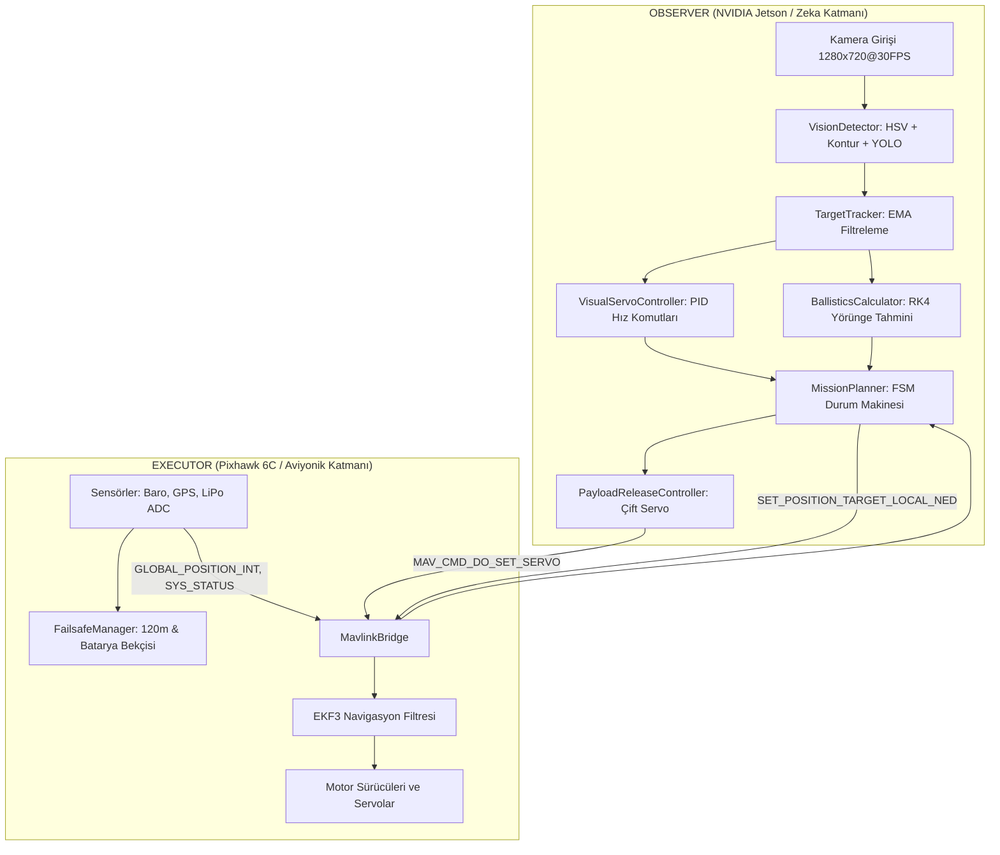

# 🛸 UAV-Architect-Global: Sistem Mimarisi ve Teknik Tasarım (Derin Dalış)

**Versiyon:** 2.0 (TEKNOFEST 2026 Uluslararası İHA Şartnamesi Uyumlu)  
**Tasarım Modeli:** Observer-Executor (Gözlemci - Yürütücü Dağıtık Mimarisi)  
**Yazar:** Bahattin Yunus Çetin  

---

## 1. Üst Düzey Vizyon ve Mimari Felsefe

UAV-Architect-Global, modern otonom hava araçlarının karşılaştığı donanım, hesaplama ve zaman kısıtlarını aşmak üzere **Observer-Executor** (Gözlemci-Yürütücü) paradigması üzerine kurulmuştur. Bu yaklaşımda:

- **Observer (Gözlemci - NVIDIA Jetson Orin Nano / Companion Computer):** Yüksek bant genişliği gerektiren algılama (kamera, YOLO/OpenCV), durum tahmin filtreleme, görsel denetimli kontrol (Visual Servoing) ve balistik bırakma optimizasyonunu üstlenir.
- **Executor (Yürütücü - Pixhawk 6C / ArduPilot EKF3):** Düşük gecikmeli, yüksek öncelikli iç döngü (inner-loop) motor stabilizasyonunu, sensör füzyonunu ve acil durum failsafe tepkilerini icra eder.

---

## 2. Alt Sistemlerin Detaylı Analizi

### 2.1. Görsel Algılama ve Geometrik Hedef Sınıflandırma (`src/vision/`)
2026 TEKNOFEST şartnamesinde yer alan spesifik hedefler için optimize edilmiştir:
- **Döner Kanat Hedefleri:**
  - *Hedef A:* 2 metre kenarlı Mavi Düzgün Altıgen (Bırakılacak Yük: **Kırmızı**).
  - *Hedef B:* 1 metre kenarlı Kırmızı Eşkenar Üçgen (Bırakılacak Yük: **Mavi**).
- **Sabit Kanat Hedefleri:**
  - *Hedef A:* 4x4 metre Mavi Dörtgen (Bırakılacak Yük: **Kırmızı**).
  - *Hedef B:* 2x2 metre Kırmızı Kare (Bırakılacak Yük: **Mavi**).

**Sınıflandırma Mantığı:**
1. Çift kanallı HSV renk segmentasyonu ile dinamik morfolojik gürültü filtresi (Opening + Closing).
2. Ramer-Douglas-Peucker (`approxPolyDP`) algoritması ile köşe sayısı doğrulaması ($N=3$ üçgen, $N=4$ dörtgen, $5 \le N \le 8$ ve dairesellik skoru $C = \frac{4\pi \cdot Alan}{\text{Çevre}^2} \approx 0.907$ altıgen).
3. `TargetTracker` ile zamansal Exponential Moving Average (EMA) sönümlemesi ve kaybolan karelerde hedef tahmin devamlılığı.

---

### 2.2. Balistik Yük Bırakma Fiziği (`src/navigation/ballistics.py`)
Yükün serbest düşüş dinamiği hava sürtünmesi ($F_d$) ve anlık rüzgar vektörü ($\vec{W}$) ile modellenir:

$$\vec{F}_{\text{net}} = m \vec{g} - \frac{1}{2} \rho C_d A \|\vec{v} - \vec{W}\| (\vec{v} - \vec{W})$$

Burada:
- $m$: Yük kütlesi ($0.250\text{ kg}$)
- $\rho$: Hava yoğunluğu ($1.225\text{ kg/m}^3$)
- $C_d$: Aerodinamik sürtünme katsayısı ($0.47$)
- $A$: Enine kesit alanı ($0.00785\text{ m}^2$)

Sistem, Runge-Kutta 4. Mertebe (RK4) sayısal integrasyonu ile milisaniye hassasiyetinde etki noktasını hesaplar ve İHA hedef merkezine **Lead Distance** ($D_{\text{lead}}$) mesafesine ulaştığında servo bırakma tetiğini çeker.

---

### 2.3. Görsel Denetimli Kontrol (`src/navigation/visual_servoing.py`)
Hedef kameranın merkez noktasından saptığında ($e_x, e_y \in [-1, 1]$), PID kontrolcü gövde ekseninde hız komutları üretir:

$$v_x(t) = - \left( K_p e_y + K_i \int e_y \, dt + K_d \frac{de_y}{dt} \right)$$
$$v_y(t) = K_p e_x + K_i \int e_x \, dt + K_d \frac{de_x}{dt}$$
$$r(t) = K_{p,\psi} e_x + K_{d,\psi} \frac{de_x}{dt}$$

Üretilen hız vektörleri, `SET_POSITION_TARGET_LOCAL_NED` MAVLink mesajı ile otopilota iletilir.

---

### 2.4. Aviyonik Güvenlik ve Failsafe (`src/avionics/failsafe.py`)
2026 kural ihlallerini ve donanım arızalarını anlık olarak izler:
1. **İrtifa Tavanı (120m AGL):** 120 metrenin 1 cm dahi aşılması yarışmada elenme sebebidir. 120m'ye ulaşıldığında sistem otonom olarak `RTL` ve kontrollü alçalma başlatır.
2. **LiPo Batarya Koruması:** 4S LiPo için 14.0V altında güvenli `RTL`, 13.2V altında `IMMEDIATE_LAND`.
3. **MAVLink Heartbeat Bekçisi:** 3.0 saniye üzerinde veri kesintisinde güvenli eve dönüş protokolü tetiklenir.

---

### 2.5. Çift Yük Bırakma Aktüatörü (`src/avionics/actuator.py`)
- **Slot 1 (Kırmızı Yük):** Hedef A kilitlendiğinde Servo CH9 üzerinden PWM 1900 $\mu s$ darbesi ile tetiklenir.
- **Slot 2 (Mavi Yük):** Hedef B kilitlendiğinde Servo CH10 üzerinden PWM 1900 $\mu s$ darbesi ile tetiklenir.
- Yanlış veya mükerrer bırakmayı önleyen yazılımsal güvenlik kilidi (Safety Interlock).

---

## 3. Donanım ve Entegrasyon Arayüzleri

| Protokol | Port / Veri Yolu | Amaç | Frekans |
| :--- | :--- | :--- | :--- |
| **MAVLink v2** | `TELEM2` / `/dev/ttyTHS1` | Uçuş telemetrisi ve komut seti | 20-50 Hz |
| **CSI-2 GStreamer** | `CAM0` / MIPI-CSI | Düşük gecikmeli 720p 60FPS video | 30-60 FPS |
| **PWM / GPIO** | `AUX 1-2` (Pixhawk) | Yük bırakma servoları | 50 Hz |
| **UDP Telemetri** | `udp:127.0.0.1:14550` | GCS / SITL simülasyon köprüsü | 10-20 Hz |

---
*Hazırlayan: Bahattin Yunus Çetin — TEKNOFEST 2026 Uluslararası İHA*
